<p align="center">
  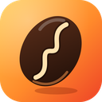
  &nbsp;&nbsp;&nbsp;
  
</p>

# focusbrew

Um tracker do dia pra quem programa, num widget colado no topo (ou na lateral) da tela. Você
planeja as tarefas de cada dia, dá play em uma, e uma linha se enche em volta
do widget enquanto o tempo corre. No fim do dia, o painel responde **o que você
fez, quanto tempo levou e em qual projeto** — e o que já está planejado pra
amanhã. E quando bate uma ideia, `Ctrl+Alt+N` abre uma **nota rápida** pra
escrever e rabiscar.

Feito com [Tauri](https://tauri.app) (Rust) + React/TypeScript. Windows.

<p align="center">
  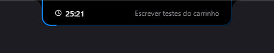
</p>

## Como funciona

- **Parado:** uma barra reta e fina no topo da tela, sem nada dentro.
- **Rodando:** a barra vira uma caixa com a contagem regressiva de um lado e o
  nome da tarefa do outro; uma linha em volta vai se enchendo. No modo
  **Minimal** a caixa mostra só a contagem, no meio.
- **Passou o mouse:** o painel abre. Quando o mouse sai, ele fecha.
- **Clicou na barra:** o painel abre **fixado** — fica aberto até você apertar
  `Esc` ou clicar fora. Bom pra planejar com calma. Se quiser, em
  **Configurações → Notch** ele fecha sozinho depois de 15, 30 ou 60 s sem você
  mexer (nunca enquanto você digita ou arrasta uma tarefa).
- **No painel:** clique no número de minutos de uma tarefa pra digitar o tempo
  (de 5 a 180); arraste pela alça pra reordenar ou soltar num dia da grade.

A barra, a caixa e o painel são uma forma só que se transforma; a janela nunca
muda de tamanho, então nada pisca nem trava. Fora da forma, o mouse passa direto
pro que está embaixo.

<p align="center">
  
  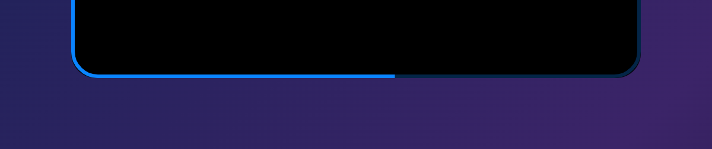
  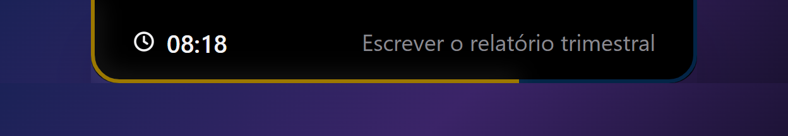
</p>

### Nas laterais da tela

Dá pra colar o widget em outra borda: em **Configurações → Notch → Posição**,
escolha Topo, Esquerda ou Direita. Nas laterais a barra fica em pé, centralizada
na altura da tela, e o painel sai da borda pra dentro da tela. Com um bloco
rodando, a lateral vira uma barra em pé só com a contagem: minutos em cima e
segundos embaixo, ou numa linha só (**Contagem na lateral**).

<p align="center">
  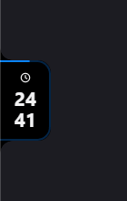
  &nbsp;&nbsp;
  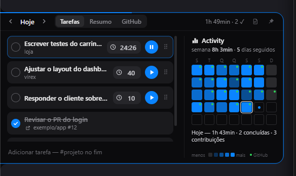
</p>

## O painel

<p align="center">
  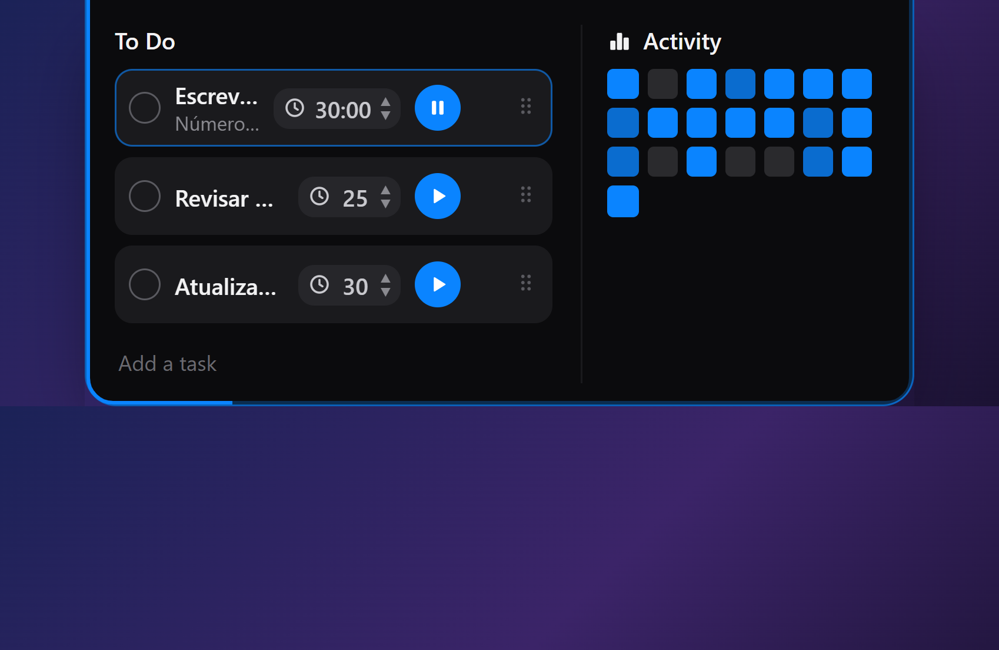
</p>

**Cabeçalho:** `‹ ›` andam pelos dias, o nome do dia ("Hoje", "Amanhã", "qui
08/10") volta pra hoje, e à direita aparece o foco do dia (e a meta, se tiver)
e quantas tarefas foram concluídas. O ícone de nota abre uma nota rápida e o
alfinete fixa o painel aberto.

### Tarefas

- Cada tarefa tem o **seu tempo** (5 a 180 min), um botão **play**, e uma alça
  pra **arrastar** e reordenar. Passando o mouse aparecem **→** (mover pro dia
  seguinte) e **×** (remover).
- **Cada dia tem a sua lista.** Escreva no campo de baixo pra criar no dia que
  está aberto. Tarefa que ficou pra trás aparece em hoje com "de 02/10" — nada
  se perde.
- **Arraste uma tarefa até um quadrado da Activity** pra planejar pra aquele
  dia.
- **Projeto:** termine o texto com `#projeto` ("Corrigir login #virex").
  **Duplo clique** no título edita (`Enter` salva, `Esc` cancela).
- Só uma tarefa roda por vez. Trocar, parar, concluir ou fechar o app guardam o
  tempo trabalhado. Quando o tempo acaba, o Windows avisa; quem marca como feita
  é você. Computador dormindo não conta.

### Resumo do dia

<p align="center">
  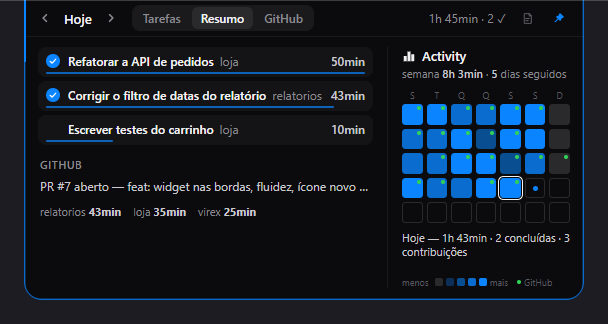
</p>

Tudo que você fez no dia: tempo por tarefa (com barrinha), o que foi concluído,
o que aconteceu no GitHub (commits, PRs, reviews) e o total por projeto. Dias
que já passaram mostram só o resumo. Com o Activity Tracking ligado (abaixo), o
resumo também mostra o tempo por app.

### Activity

Cinco semanas: as três anteriores, a atual e a **próxima** (pra planejar).
Quanto mais foco, mais forte o azul; o ponto verde marca dias com contribuição
no GitHub; o ponto azul num dia futuro marca tarefa planejada. **Clique num
quadrado** pra abrir aquele dia. Em cima, o total da semana e a sequência de
dias seguidos com foco; embaixo, a descrição do dia sob o mouse.

### GitHub

<p align="center">
  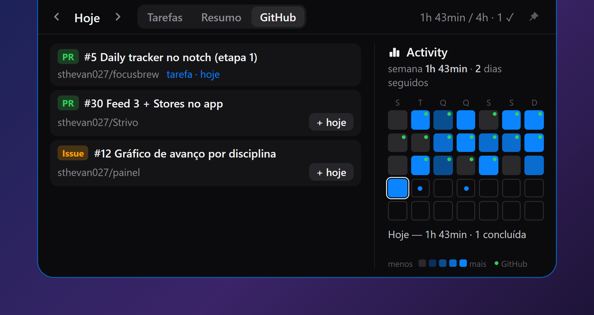
</p>

Os PRs e issues abertos que envolvem você. **+ hoje** (ou o dia aberto) cria a
tarefa com o link e o repositório como projeto. Um PR que **já é tarefa** mostra
pra qual dia está planejado ("tarefa · amanhã") e oferece trazer pro dia aberto,
em vez de duplicar.

<p align="center">
  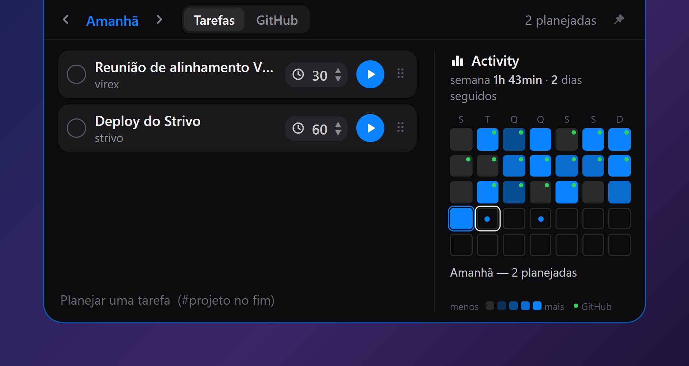
</p>

### Agenda

Com a Google Agenda conectada, aparece a aba **Agenda**, com os eventos do dia
aberto. Marcar um evento cria uma tarefa planejada pra esse dia, com a duração
do evento; evento que já virou tarefa aparece marcado e não duplica. Evento com
✓ no título entra como tarefa concluída. Como conectar e o que sincroniza:
[Conectar a Google Agenda](#conectar-a-google-agenda).

### Música

Quando o Windows tem uma mídia tocando (qualquer app), aparecem a capa, o título
e o progresso. Os botões **anterior, play/pausa e próxima** ficam no notch
enquanto a música toca; pra tirar, **Configurações → Notch → Controles de
música**. Sem tarefa rodando, a caixa mostra a música; com uma tarefa rodando,
a tarefa fica na frente e **Ctrl+scroll** alterna entre as duas. A aba
**Música** do painel mostra a versão maior. Nada disso é guardado: o focusbrew
lê o que o Windows informa, a cada segundo.

## Notas rápidas

Pra quando bate uma ideia ou você quer explicar algo rabiscando: `Ctrl+Alt+N`
(ou o botão de nota no cabeçalho do painel) abre uma nota nova de qualquer
lugar, sem tirar você do que estava fazendo.

<p align="center">
  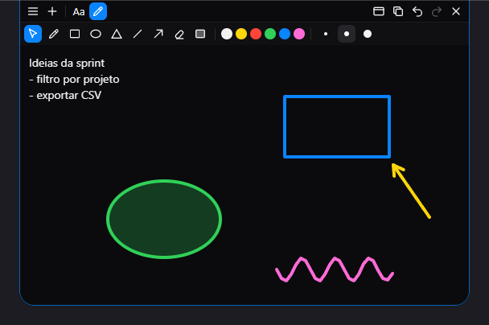
</p>

- **Aa** pra escrever (a primeira linha vira o título) e **✎** pra desenhar:
  caneta, quadrado, círculo, triângulo, linha e seta (com `Shift` ficam
  proporcionais ou em ângulos de 45°), preenchimento, 6 cores e 3 espessuras,
  borracha e seleção (mover, redimensionar pelos cantos, `Delete` apaga).
- `Ctrl+Z` / `Ctrl+Shift+Z` desfazem e refazem o desenho.
- **Imagens:** cole um print com `Ctrl+V` (até 10 por nota). O botão de copiar
  põe a nota inteira no clipboard como imagem.
- **Tudo salva sozinho.** Nota vazia não é guardada. `Esc` fecha.
- **Histórico:** ☰ (ou `Ctrl+H`) abre a lista das notas com miniatura e um filtro
  por texto; **+** (ou `Ctrl+N`) começa outra. Apagar pede uma confirmação
  rápida no próprio item.
- **Onde abre:** sobre o painel do widget (padrão) ou numa janela no meio do
  monitor. O botão de janela na nota troca na hora, sem perder nada. Com uma
  nota já aberta, o atalho só traz ela pra frente e pisca a borda.

<p align="center">
  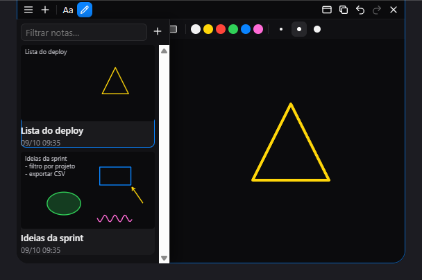
  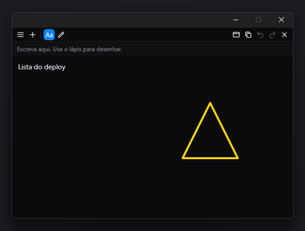
</p>

A aba **Notas** da configuração mostra todas as notas numa galeria; clicar abre
a nota.

<p align="center">
  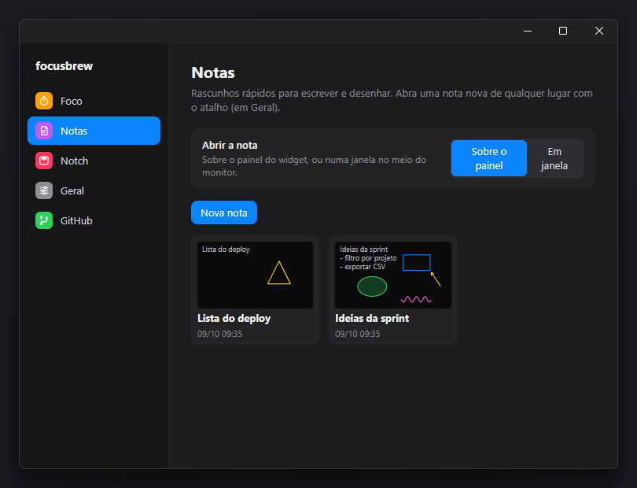
</p>

## Atalhos

| Atalho (padrão) | O que faz |
|---|---|
| `Ctrl+Shift+Space` | pausa/retoma o bloco; parado, inicia a primeira tarefa de hoje |
| `Ctrl+Shift+Alt+Space` | abre/fecha o painel fixado |
| `Ctrl+Alt+N` | abre uma nota rápida nova |

Os três mudam em **Configurações → Geral** (clique e aperte a combinação). Se
outro programa já usa uma combinação, o focusbrew avisa qual e o outro atalho
continua funcionando.

## Configurações

Clique no ícone da bandeja (ou **Abrir configurações** no menu dele).

<p align="center">
  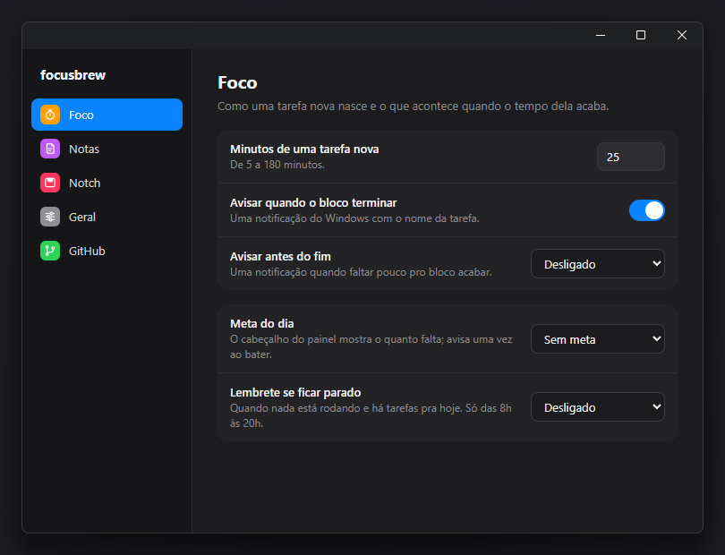
</p>

| Seção | O que muda |
|---|---|
| **Foco** | minutos de uma tarefa nova; aviso no fim do bloco e **antes do fim**; **meta do dia**; **lembrete se ficar parado** (só das 8h às 20h) |
| **Notas** | galeria das notas rápidas (escrever, desenhar, imagens), onde elas abrem (sobre o painel ou em janela) |
| **Notch** | estilo Standard ou Minimal; **posição** (topo, esquerda, direita) e contagem na lateral; linha de progresso; linha RGB; cor de destaque; **controles de música**; fechar o painel fixado sozinho |
| **Atividade** | só aparece com o Activity Tracking ligado: tempo por app (dia, semana ou mês), o limite de ocioso e por quanto tempo guardar os dados |
| **Geral** | mostrar o widget; **monitor** do widget; **iniciar com o Windows**; **Activity Tracking** (em teste); os três atalhos; versão e **atualizações** |
| **GitHub** | conectar pelo login do `gh` (ou um token) |
| **Google Agenda** | conectar ou desconectar a conta (o que sincroniza, em [Conectar a Google Agenda](#conectar-a-google-agenda)) |

<p align="center">
  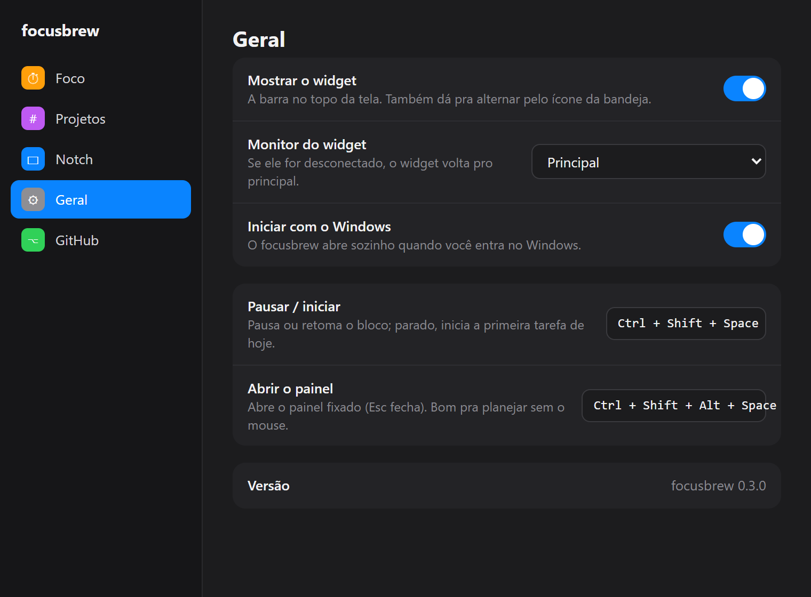
</p>

### Conectar o GitHub

Se o [GitHub CLI](https://cli.github.com) estiver instalado e logado
(`gh auth login`), a aba GitHub mostra **Conectar com o GitHub CLI**, sem token
pra colar. Sem o `gh`, dá pra usar um Personal Access Token (guardado no cofre
de credenciais do Windows). PRs, issues, contribuições e a sua atividade
atualizam ao abrir o app e a cada 5 minutos.

### Conectar a Google Agenda

Em **Configurações → Google Agenda**, **Conectar com o Google** abre o navegador
pra você autorizar. O focusbrew recebe a volta em `127.0.0.1:53682`, então essa
porta precisa estar livre na hora. Só a agenda principal da conta é usada.

A sincronização roda com o app aberto, enquanto a conta estiver conectada: uma
vez logo depois de abrir e depois a cada 5 minutos. Ela cuida só das **tarefas
de hoje**; tarefa de outro dia não é tocada.

- Tarefa de hoje sem evento ganha um evento novo, com a duração da tarefa,
  começando no horário da sincronização.
- Título e ✓ de concluída são conciliados nos dois lados a cada sincronização
  (até 5 min). Se os dois lados mudaram, **a edição mais recente vence**.
- Apagar a tarefa no focusbrew apaga o evento. Evento apagado ou cancelado no
  Google tira a tarefa de hoje do focusbrew.
- Tarefa vinda do GitHub nunca vai pra agenda.
- **Desconectar** apaga o acesso salvo e desvincula as tarefas: elas continuam,
  mas os eventos ficam na agenda do Google. Se o Google revogar o acesso, o app
  pede pra conectar de novo, e as tarefas continuam vinculadas.

## Activity Tracking (em teste)

Mostra quanto tempo você passou em cada app, pelo nome do executável (`Code.exe`,
por exemplo). Aparece no **Resumo do dia** e na seção **Atividade** das
configurações. Não confunda com a grade **Activity** do painel: é outra coisa.

Vem desligado e não é um processo do app: é um serviço separado, o
`focusbrew-tracker` (código em `src-tauri-service/`), que roda na sua sessão do
Windows e guarda os dados no próprio computador.

### Como ligar

1. Em **Configurações → Geral**, ligue **Activity Tracking (em teste)**.
2. Instale o serviço, a partir da raiz do repositório (não precisa de administrador):

   ```powershell
   cargo build --release --manifest-path src-tauri-service\Cargo.toml
   .\src-tauri-service\install-autostart.ps1 -ExePath src-tauri-service\target\release\focusbrew-tracker.exe
   ```

O script copia o programa pra `%LOCALAPPDATA%\focusbrew\bin`, configura a
abertura no login (chave `Run` do usuário) e espera o serviço responder. Pra
tirar a inicialização: `.\src-tauri-service\install-autostart.ps1 -Uninstall`
(os dados ficam).

Com o Activity Tracking desligado, o app não fala com o serviço. Ligado e com o
serviço parado, a seção Atividade mostra "offline".

### O que fica local

- `%LOCALAPPDATA%\focusbrew\activity.db` (SQLite): para cada trecho em um app, o
  nome do executável, o início, o fim e se foi ocioso. Também guarda as duas
  configurações do serviço (limite de ocioso e retenção). Não tem título de
  janela nem conteúdo, e o serviço não faz nenhuma requisição pra fora.
- `%LOCALAPPDATA%\focusbrew\tracker.log`: erros do serviço.
- A API do serviço escuta só em `127.0.0.1:8765`.
- **Ocioso:** sem teclado ou mouse por mais que o limite (de 1 a 60 min; padrão
  10). Esse tempo é contado à parte e não entra no tempo de cada app.
- **Retenção:** registros mais velhos que o prazo escolhido (30, 90 ou 180 dias)
  são apagados.

## Instalação

Baixe o instalador mais recente em
[Releases](https://github.com/sthevan027/focusbrew/releases)
(`focusbrew_<versão>_x64-setup.exe`).

O instalador é de **um clique**: instala só pro usuário atual (sem pedir
admin), sem telas de assistente, cria atalhos na área de trabalho e no menu
Iniciar e abre o app ao terminar.

Se o SmartScreen avisar na primeira execução (o certificado é interno),
clique em **Mais informações → Executar assim mesmo**.

Pra desinstalar: **Configurações → Apps → Apps instalados → focusbrew**.

## Site

A página de divulgação fica em `site/` (Vite + React + TypeScript, com Bun) e é
publicada na Netlify (o `netlify.toml` da raiz aponta pra `site/`). Tem o botão
**Baixar para Windows**, que lê a última release na API do GitHub (e cai pra
v0.4.1 se a API falhar), "Como funciona", prints do painel, privacidade,
instalação (com o aviso do SmartScreen) e as novidades de cada versão. Cores e
fonte são as do próprio app.

No topo da página tem um **vídeo de 27 s, com narração e trilha**, mostrando o
uso de verdade: a barra no topo da tela, o painel, o play com a linha de
progresso, PRs e issues do GitHub virando tarefa, a nota rápida com `Ctrl+Alt+N`
e a grade de atividade.

<p align="center">
  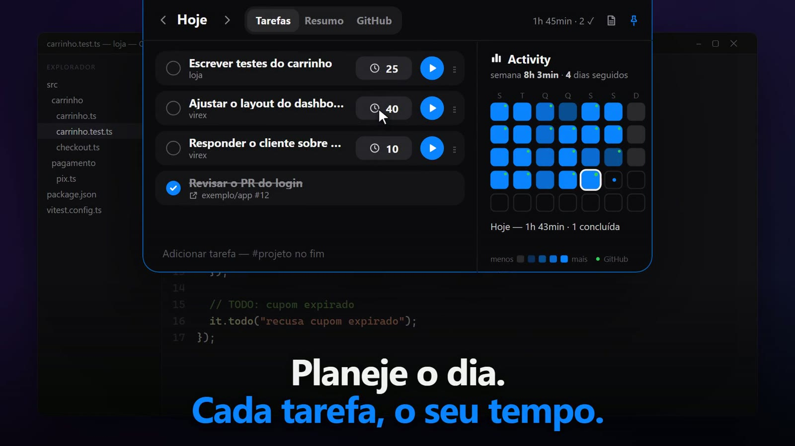
</p>

## Desenvolvimento

Pré-requisitos: [Rust](https://www.rust-lang.org/tools/install) + o Visual
Studio Build Tools com o workload "Desktop development with C++" (veja os
[pré-requisitos do Tauri](https://tauri.app/start/prerequisites/)) e o [Bun](https://bun.sh).

```bash
bun install
bun run tauri dev      # app em desenvolvimento
bun run test           # contas do front-end (vitest)
cargo test --manifest-path src-tauri/Cargo.toml   # regras do timer, tarefas, alertas e configurações
cargo test --manifest-path src-tauri-service/Cargo.toml   # o serviço de Activity Tracking
bun run dist            # instalador em src-tauri/target/release/bundle/nsis/
bun run dist:signed     # o mesmo, assinado (certificado em src-tauri/tauri.signing.conf.json)
```

Pra conectar a Google Agenda num build local, defina `FOCUSBREW_GOOGLE_CLIENT_SECRET`
antes de compilar. Sem ela o app compila, mas a conexão falha. O valor não vai
pro repositório.

### Publicar uma versão (com atualização automática)

O app checa sozinho, ao abrir, o `latest.json` da release mais recente
(`https://github.com/sthevan027/focusbrew/releases/latest/download/latest.json`)
e, em **Configurações → Geral → Atualizações**, baixa e instala a versão nova
com um clique. Cada atualização é conferida contra a chave pública do
`tauri.conf.json` (`plugins.updater.pubkey`), então toda release precisa ser
assinada com a chave privada correspondente.

A chave privada fica **fora do repositório**, em `~/.tauri/focusbrew-updater.key`
(gerada com `bun x @tauri-apps/cli signer generate --ci -p <senha> -w <arquivo>`).
Guarde a senha e um backup da chave: sem elas, as versões já instaladas nunca
mais aceitam uma atualização, só reinstalando na mão.

1. Suba a versão em `package.json`, `src-tauri/Cargo.toml` e `src-tauri/tauri.conf.json`.
2. Exporte a chave (arquivos `.env` não funcionam) e gere o instalador assinado:

   ```powershell
   $env:TAURI_SIGNING_PRIVATE_KEY = Get-Content "$HOME\.tauri\focusbrew-updater.key" -Raw
   $env:TAURI_SIGNING_PRIVATE_KEY_PASSWORD = "<a senha da chave>"
   bun run dist:signed
   ```

3. Monte o `latest.json` a partir do `.sig` que o build deixou ao lado do instalador:

   ```bash
   bun run tools/make-latest-json.ts <versão> "<o que mudou>"
   ```

4. Publique a release **com a tag `v<versão>`** (o `latest.json` aponta o instalador pra `/releases/download/v<versão>/`; outra tag dá 404 em todas as máquinas) e com os três arquivos de `src-tauri/target/release/bundle/nsis/`:
   `focusbrew_<versão>_x64-setup.exe`, `focusbrew_<versão>_x64-setup.exe.sig` e `latest.json`.

O instalador usa uma cópia do template NSIS do Tauri
(`src-tauri/windows/installer.nsi`, base `tauri-cli` 2.11.4) que força o modo
passivo; se atualizar o `@tauri-apps/cli`, compare com o template novo.

### Como o código está organizado

```
src-tauri/src/
  tracker/        o coração, sem Tauri: timer por horário final, tarefas por dia,
                  histórico de blocos e tempo por projeto
  alerts.rs       aviso antes do fim, meta do dia, lembrete de parado (puro)
  shortcuts.rs    os três atalhos globais, cada um registrado por conta própria
  notes.rs        as notas rápidas: arquivo atômico, limites, imagens em disco
  note_window.rs  a janela da nota e o que o atalho faz com uma nota já aberta
  media.rs        a mídia do Windows (SMTC): capa, progresso e os controles
  google_calendar.rs  OAuth da Google Agenda (PKCE) e chamadas à API
  google_sync.rs  a regra de sincronia, pura: o que fazer com cada tarefa de hoje
  activity_tracking/  cliente do serviço de Activity Tracking (127.0.0.1:8765)
  autostart.rs    iniciar com o Windows (chave Run do usuário)
  widget.rs       janela do widget: tamanho fixo, colada no topo, mouse atravessando
  config.rs       configurações (lê qualquer arquivo, antigo ou quebrado, sem falhar)
  state.rs        o estado e o que a interface recebe
  commands.rs     os comandos que a interface chama
  github.rs       login pelo gh/token, PRs e issues, contribuições, atividade
  lib.rs          bandeja, atalhos, o relógio de 1 s, notificações
src-tauri-service/  o serviço focusbrew-tracker (Activity Tracking): olha o app em
                  primeiro plano a cada segundo, grava em SQLite (activity.db) e
                  responde pela API local; install-autostart.ps1 instala no login
site/             a landing page (Vite + React + TS), publicada na Netlify; netlify.toml fica na raiz
tools/            make-latest-json.ts: gera o latest.json da release
src/
  Widget.tsx      a janela do widget (a forma que vira barra, caixa ou painel)
  widget/         Panel, TaskList, TaskRow, DaySummaryView, GithubTab, AgendaTab,
                  ActivityPanel, ActivitySummaryWidget, Notch, ProgressLine,
                  MediaBox, MediaControls, MediaTab
  NoteWindow.tsx  a janela da nota rápida
  note/           o editor da nota, o desenho (SVG), o histórico e as imagens
  App.tsx         a janela de configurações
  settings/       as seções
  components/     os painéis de Atividade, GitHub e Google Agenda nas configurações
  lib/            contas puras (dias, resumo, grade, GitHub, agenda, atividade,
                  atalhos) com testes
```

O backend guarda *qual tarefa está rodando* e *quando ela termina*; a interface
só desenha a partir desse horário, sem contar tempo por conta própria. Os
dados ficam em `%APPDATA%\sthevandev\focusbrew\` (`config\settings.json`,
`data\tasks.json`, `data\notes.json` (+ `data\notes\images\`), `data\activity.json` — este com o histórico de blocos dos
últimos 400 dias).

Os tokens não ficam nesses arquivos: o refresh token do Google e o token do GitHub
colado à mão ficam no Gerenciador de Credenciais do Windows, e o login do `gh` é
lido na hora, sem ser guardado. Tarefa ligada à agenda guarda só o id do evento
(`google_event_id`, em `tasks.json`). O Activity Tracking guarda os dados em
`%LOCALAPPDATA%\focusbrew\` (acima).

## Licença

MIT.
